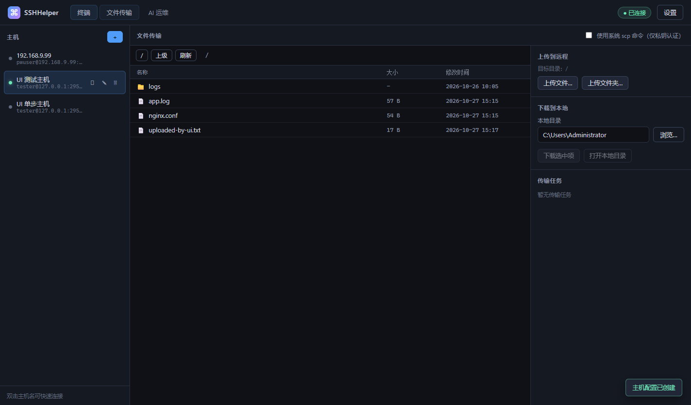
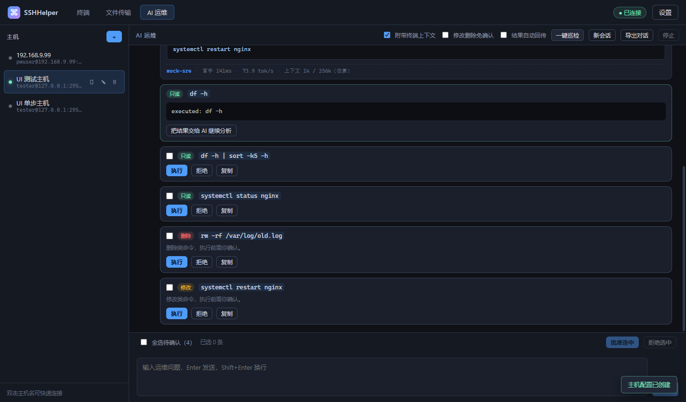
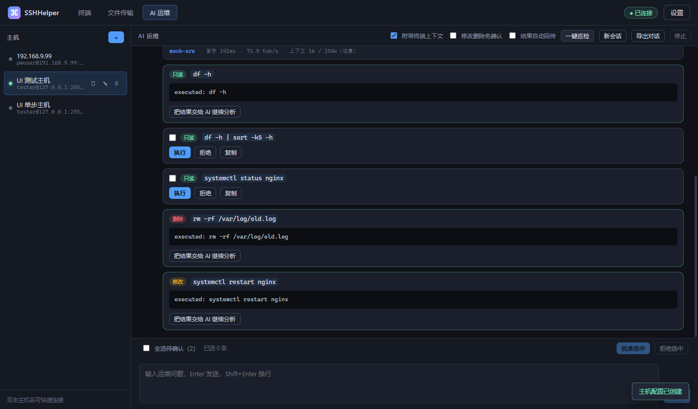
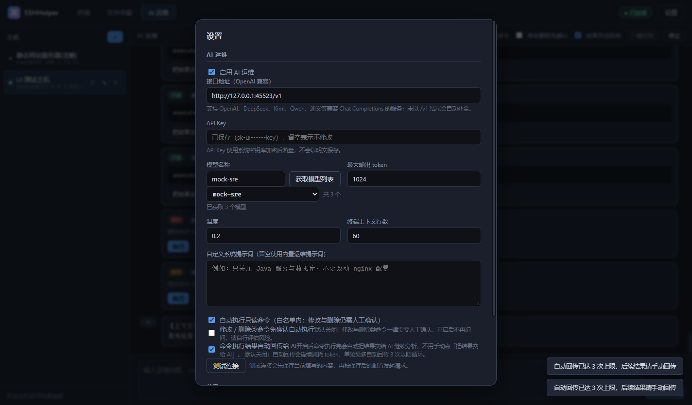
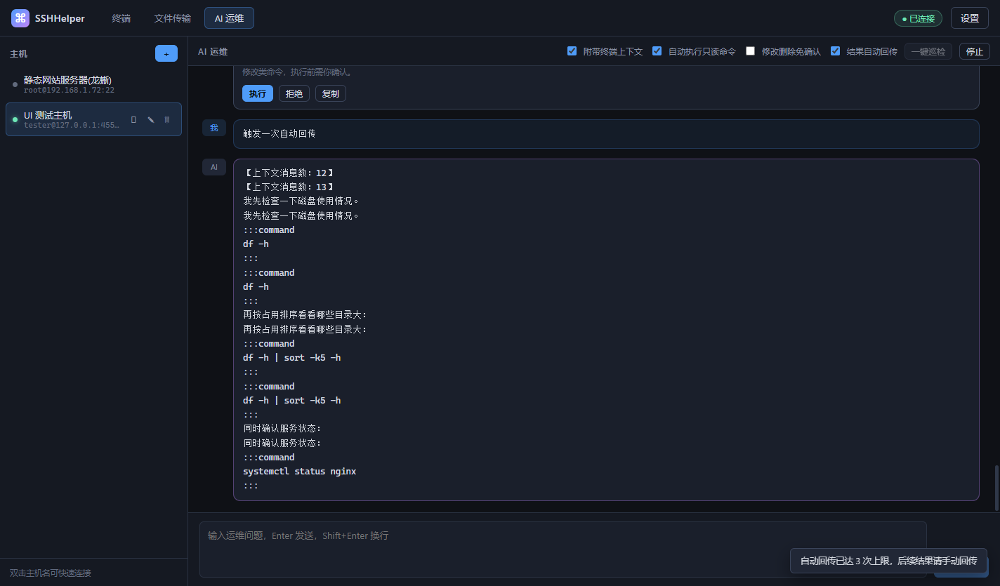

# AgentSSHelper

Windows 桌面端 SSH 运维工具：**SSH 远程管理 + SCP/SFTP 文件传输 + 系统密钥库加密凭据 + 外部 AI 运维助手**。

基于 Electron + TypeScript 构建，SSH 协议栈使用 [ssh2](https://github.com/mscdex/ssh2)，终端使用 xterm.js。

## 界面预览

| 交互式终端 | 文件传输 |
| --- | --- |
|  |  |

| AI 运维 | 命令执行与回传 |
| --- | --- |
|  |  |

| 设置：自动获取模型列表 |
| --- |
|  |

| 命令卡片串在对话中 · 结果自动回传 |
| --- |
|  |
---

## 功能

### 1. SSH 远程管理

| 能力 | 说明 |
| --- | --- |
| 认证方式 | 口令登录、私钥登录（支持 passphrase）、SSH Agent 转发 |
| 键盘交互认证 | 服务器只提供 keyboard-interactive 时自动应答 |
| 交互式终端 | xterm.js 终端，实时回显，支持窗口尺寸自适应 |
| 远程执行 | `exec` 非交互执行，捕获 stdout / stderr / 退出码，支持超时与中断 |
| sudo 支持 | `sudo -S` 注入口令；终端中检测到 sudo 提示可自动应答 |
| 主机密钥校验 | 首次连接记录 OpenSSH 风格 `SHA256:` 指纹，之后指纹变更直接拒绝连接（防中间人） |
| 保活 | SSH keepalive 15s / 最多 4 次无应答 |

### 2. 文件传输（SCP / SFTP）

- 远程目录浏览：面包屑导航、目录 / 文件图标、大小与修改时间
- 上传文件 / 上传文件夹（递归）、下载文件 / 下载目录（递归）
- 流式读写（64KB 分块），**实时进度上报**，支持随时取消
- **远程文本编辑器**：在文件列表点「编辑文本」即可在线打开远端文本文件（基于 Monaco Editor），支持多语言语法高亮、`Ctrl+F` 查找、`Ctrl+S` 保存回远端；按扩展名排除已知二进制，无后缀的配置文件 / 脚本也允许尝试编辑
- 两种传输后端可切换：
  - **内置 SFTP**（默认）：支持口令认证，功能完整
  - **系统 scp 命令**：调用系统 OpenSSH `scp`，仅支持私钥 / agent 认证（OpenSSH 的 scp 无法从标准输入安全读取口令）

### 3. 凭据加密存储

- 主选后端：**Electron `safeStorage`**
  - Windows → DPAPI（绑定当前用户与机器）
  - macOS → Keychain
  - Linux → libsecret / kwallet
- 自动识别 Linux 上退化为 `basic_text`（等价明文）的情形，此时不信任该后端
- 降级后端：系统密钥库不可用时，用 `scrypt` 派生本地主密钥（随机盐 + 机器/用户指纹）做 AES-256-GCM 加密，界面会明确提示当前后端
- 口令、私钥 passphrase、API Key **均不以明文落盘**，配置文件中只存密文
- 支持密钥轮换：系统密钥更新后自动重新加密

### 4. AI 运维（OpenAI 兼容接口）

- 接入任意 OpenAI Chat Completions 兼容服务：OpenAI、DeepSeek、Kimi、Qwen、通义、硅基流动、Ollama、vLLM 等
- 流式输出（SSE 解析）
- **Markdown 渲染**：AI 回复按 Markdown 渲染（标题、列表、表格、引用、代码块），`:::command` 协议块自动转成代码块；不解析原始 HTML，链接统一交给系统浏览器打开
- **运行时指标**：每条回复下方显示**模型名**、首字延迟、输出速度（tokens/s）、上下文占用（已用 / 最大上下文）；服务端未返回 usage 时自动本地估算并标注「估算」
- **最大上下文可配置**：默认 `262144`（256k），请求前按 token 预算裁剪历史，避免 prompt + 输出超出模型窗口
- **自动获取模型列表**：点「获取模型列表」调用服务端的 `GET /models`，下拉选取后自动回填模型名称；服务不支持该接口时给出提示并保留手动填写
- **命令提案 + 人工审批**：AI 用 `:::command` 块提出命令，界面按风险分级展示

  | 等级 | 标签 | 覆盖范围 | 默认行为 |
  | --- | --- | --- | --- |
  | `safe` | 只读 | 只读白名单内的命令（`ls` `df` `free` `cat` `journalctl` `systemctl status` `awk` `grep` `sed -n` …），以及**每一段都是只读的管道**（`df -h \| sort -k5 -h`、`awk '{print $1}' f \| sort \| uniq -c`） | **自动执行**（无副作用；每轮只保留并执行一条命令） |
  | `modify` | 修改 | 改变系统或文件状态（`chmod` `chown` `mv` `cp` `systemctl restart` `apt install` `git push` `sudo` `sed -i` `tee` …） | **一律需人工确认** |
  | `delete` | 删除 | 删除数据（`rm` `rmdir` `shred` `mkfs` `dd` `docker rm` `kubectl delete` `git clean` `find -delete` …） | **一律需人工确认** |
  | `risky` | 需确认 | **写文件重定向**（`> file`、`2> file`）、命令替换（`$( )`）、未知程序、自研脚本、无法静态判定的命令 | **始终需人工确认，永不自动执行** |

  分级采用**引号感知的 shell 拆分**：命令按 `|` `;` `&&` 拆成片段逐段分级，只要每段都是只读，整条命令才算只读；引号内的 `|` `>`（awk 的正则、sed 的脚本）属于程序内容，不会被当成 shell 语法。路径与引号内容不参与关键词匹配，因此 `awk '{print $2}' /etc/passwd` 不会被误判成「修改」，而 `find . -delete` 会被正确判成「删除」。

  只读命令无副作用，**始终自动执行，不再显示批准按钮**（消除「只读类型却要人工确认」的歧义）。**丢弃式重定向**（`>/dev/null`、`2>/dev/null`、`2>&1`）不写文件，不改变只读判定；只有**写文件重定向**（`> file`）才会触发人工确认。用户可在「设置」或 AI 面板工具栏勾选 **修改删除免确认**，让修改 / 删除类命令也不再询问（默认关闭）。无法静态判定的命令不受该开关影响，始终需要确认。

**每轮最多一条执行命令**：每个命令块只放一条命令，系统提示词强制要求 AI 一轮最多给一条。即便 AI 一次返回多条，**只保留并展示第一条**，其余一律丢弃、不建任何卡片，避免基于假设的执行错误。开启「结果自动回传」后，第一条执行结果自动交回 AI，AI 依据**真实输出**续算出正确的下一步。<br><br>凡需人工确认的命令（含整条被保留的第一条若属修改/删除/risky），可勾选后点「批准选中」/「拒绝选中」一次批处理。

- 执行结果可一键回传给 AI 继续分析；也可在「设置」或 AI 面板工具栏开启 **结果自动回传**，命令执行完自动交给 AI（不设次数上限，AI 可连续提命令并自动分析结果；随时可点「停止」终止）
- **命令批量审批**：多条命令待确认时，可勾选命令后点「批准选中」/「拒绝选中」一次处理，不必逐条点击；单条卡片的「执行」/「拒绝」按钮仍保留
- **命令审批卡片串在对话中**：每条命令卡片显示在触发它的那条 AI 回复下方，不再全部堆到对话底部
- **多轮对话上下文**：同一台主机的对话会完整延续（system + 最近 20 条），模型能记得前面问过什么、给过什么命令结果；终端最近输出只随当次请求附带，不在历史里重复堆积
- **一键巡检**：自动采集 `uname` / `os-release` / `uptime` / `free` / `df` / `lsblk` / `systemctl --failed` / `dmesg` / `journalctl` 等只读诊断信息，交给 AI 生成健康报告与处置建议
- **对话日志导出**：工具栏「导出对话」把当前会话（含命令执行结果）导出为 Markdown 日志，便于复盘与分享
- **长时命令实时进度**：`yum update` 这类耗时命令执行时，卡片实时滚动输出与状态，不再干等最终结果
- **服务器实时资源占用**：顶部栏常驻显示已连接服务器的 **CPU / 内存** 占用进度条（每 2 秒采样刷新），切换主机自动跟随
- **AI 处理中指示**：提交问题后显示「AI 处理中」动画 + 累计等待时间，可一键 **取消** 本次提问
- **新会话**：点「新会话」一键清空当前对话与该会话的上下文，让下一轮从全新上下文开始；正在进行的请求会先被停止
- **内置 Linux 运维知识库**：将精选的 Linux 运维技能（性能排查 / 网络排障 / Nginx 与日志分析 / 系统安全加固基线）提炼成命令速查表注入 AI 的系统提示词，让 AI 在分析、排障、回复时直接套用 `ss -tlnp`、`iostat -x`、`journalctl --since`、`awk` 日志统计等专业命令，避免空泛建议
- **联网搜索增强（百度搜索）**：可在「设置」中启用并配置**百度 API Key**（千帆 ModelBuilder / AppBuilder）。开启后，AI 面板工具栏显示「**联网搜索**」徽标；当提问命中需要检索的信号（CVE 编号、版本/配置、漏洞补丁、第三方软件文档等）时，自动调用百度 AI 搜索获取最新摘要注入上下文后再回答，**命中了检索的回复，界面会标记「🔎 已联网检索」**。按百度免费额度（**日 50 次 / 月 1500 次**）在设置里展示实时用量比例。面向国内网络直连可用。
- 自动注入上下文：当前主机信息、系统版本、工作目录，以及终端最近输出（可关闭）

---

## 快速开始

```bash
npm install          # 首次安装（Electron 二进制需从镜像源下载）
npm run dev          # 开发模式（热更新）
npm run build        # 构建到 out/
npm run dist:win     # 打包 Windows 免安装版，输出到 release/
npm run typecheck    # 类型检查
```

> 国内网络环境建议设置镜像：
> ```powershell
> $env:ELECTRON_MIRROR='https://npmmirror.com/mirrors/electron/'
> $env:ELECTRON_BUILDER_BINARIES_MIRROR='https://npmmirror.com/mirrors/electron-builder-binaries/'
> ```

### 使用步骤

1. 左侧点击 **＋** 新建主机配置，填写地址 / 端口 / 用户名 / 认证方式，保存口令或选择私钥文件
2. 点击主机右侧的 **▶** 连接（首次连接会记录服务器主机密钥指纹）
3. **终端** 标签页进行交互式操作；**文件传输** 标签页上传下载；**AI 运维** 标签页对话与巡检
4. 右上角 **设置** 填写 AI 接口地址、API Key，点「获取模型列表」从服务端拉取可用模型并选取；点「测试连接」验证（测试会先保存当前填写的内容，再按保存后的配置发起请求）
5. （可选）需要 AI 联网搜索时，在「设置 → 启用联网搜索增强（百度搜索）」勾选并填入**百度 API Key**，可在设置里查看日 / 月免费额度用量比例
6. 配置保存后 **AI 运维** 面板会立即可用；若仍显示「尚未配置 AI 服务」，点面板里的「重新检测」即可

---

## 项目结构

```
src/
├── main/                    主进程
│   ├── index.ts             应用启动、窗口、会话事件广播
│   ├── ipc.ts               全部 IPC 接口
│   ├── core/
│   │   ├── vault.ts         凭据保险库（safeStorage / scrypt 降级）
│   │   └── store.ts         主机配置 / AI 配置 / 搜索配额持久化
│   ├── ssh/
│   │   ├── connection.ts    SSH 连接、shell、exec、SFTP 句柄
│   │   ├── manager.ts       会话生命周期管理
│   │   └── transfer.ts      文件传输（流式读写 + 系统 scp）
│   ├── ai/
│   │   ├── client.ts        OpenAI 兼容客户端（SSE 流式）
│   │   └── ops.ts           命令分级、命令块解析、巡检编排、联网搜索注入
│   └── search/
│       └── baiduSearch.ts   百度 AI 搜索代理（启发式判定 + 摘要注入）
├── shared/
│   └── types.ts              主进程 / 渲染层共享的类型与 IPC 事件契约
├── preload/
│   └── index.ts              contextBridge 安全桥接（通道白名单）
├── renderer/src/            React 渲染层
│   ├── App.tsx               应用壳（标签页布局、设置弹窗、配置版本联动）
│   ├── main.tsx              渲染层入口（挂载根组件）
│   ├── api.ts                封装 preload 暴露的 API
│   ├── terminalBuffer.ts     终端输出缓冲
│   ├── monaco-setup.ts       Monaco 编辑器按需注册语言
│   ├── components/
│   │   ├── AIPane.tsx          AI 运维面板（对话 / 命令卡片 / 联网检索标记）
│   │   ├── TerminalPane.tsx    交互式终端
│   │   ├── TransferPane.tsx    文件传输面板（含远程编辑器入口）
│   │   ├── TextEditorDialog.tsx 远程文本编辑器（Monaco，Ctrl+S 保存）
│   │   ├── SettingsDialog.tsx  设置弹窗（AI / 搜索增强 / 密钥）
│   │   ├── HostDialog.tsx      主机配置弹窗
│   │   ├── Sidebar.tsx         主机列表侧栏
│   │   ├── Markdown.tsx        AI 回复 Markdown 渲染（:::command 协议块）
│   │   └── Modal.tsx           通用弹窗外壳（只接受明确的关闭意图）
│   └── styles.css
├── test/                    自动化测试
│   ├── fakeSshServer.ts     本地假 SSH 服务端（exec / shell / SFTP）
│   ├── smoke.ts             端到端冒烟测试（当前 120 项）
│   └── testEnvMain.ts       UI 验证用本地测试环境
scripts/                     构建 / 测试辅助脚本（UI 回归、打包清理、mock 等）
docs/screenshots/            界面预览截图
resources/                   打包随附资源
build/icon.ico               应用图标（由 scripts/make-icon.mjs 生成）
```

### 安全设计

- 渲染进程开启 `contextIsolation`、关闭 `nodeIntegration`，通过 `contextBridge` 暴露白名单 API
- 事件订阅通道使用白名单，拒绝订阅未授权通道
- 渲染层 CSP 禁止外部脚本
- 外部链接统一交给系统浏览器打开，不在应用内加载
- **AI 命令执行策略在主进程强制执行**，不是仅靠界面拦截：
  - 渲染层**没有**直接执行命令的接口，`ai:runCommand` 已移除，只保留 `ai:approveCommand`
  - 命令必须先由 AI 提出并进入主进程的待确认队列，才能被批准执行
  - 主进程按风险等级决定是否自动执行；修改 / 删除类默认必须人工确认
  - 不在待确认队列中的命令 id 无法被批准执行
  - 系统提示词同步告知模型「修改与删除需用户确认」，降低模型越权倾向

---

## 测试

```bash
npm test               # 构建 + 端到端冒烟测试（120 项）
npm run typecheck      # 类型检查
```

冒烟测试会启动一个本地假 SSH 服务端，覆盖：凭据加密落盘与还原、SSH 连接与主机密钥校验、exec 退出码、exec 超时中断且命令不重复下发、交互式 shell、SFTP 目录列举 / stat / 上传 / 下载 / 取消、命令风险四级分级、命令块解析、AI 流式分片拼接、AI 连通性、巡检上下文采集、**命令审批策略**（删除/修改类默认挂起待确认、批准后执行、拒绝不执行、未挂起命令无法批准、开启免确认开关后修改类自动执行、risky 命令永不自动执行），以及**联网搜索增强**（启发式判定：CVE / 最新版 / 稳定版命中、本机系统 / 版本查询不误触、闲聊不触发；百度 `references[]` 响应解析、配额计数、Key 加密落盘与清除、系统提示注入联网检索引导）。

UI 端到端验证（需先构建）：

```bash
npm run test:env                                  # 启动假 SSH + 假 AI 服务
npm run test:ui:app                               # 以「隔离用户数据目录」启动应用（UI 测试专用，见下）
npm run test:ui -- 9333 ./docs/screenshots <sshPort> <aiBaseUrl>
```

> **为什么用 `npm run test:ui:app`？** UI 回归会在应用里预置一份模拟的 SSH / AI 配置。若直接用 `npx electron .` 启动，这些模拟值会写进真实数据目录 `%APPDATA%\sshelper` 下的 `ai.json`、`profiles.json`，把用户真实的 AI 配置和主机配置覆盖掉 —— 表象就是「每次更新版本 / 跑完测试后 ai 配置丢了」。`test:ui:app` 启动时通过 `SSHELPER_USER_DATA` 把数据目录重定向到一个独立的临时目录，确保 UI 测试的所有写入都落在此目录，**绝不触碰真实配置**。

UI 验证覆盖：连接、文件传输、子目录导航、上传下载往返内容比对、AI 面板命令卡片、**命令卡片串在对应回复下方**、风险四级分级与审批、删除类命令批准执行、**只读命令（含只读管道）在开关开启后自动执行**、**命令结果自动回传给 AI**（断言用户无操作时回复数自动增加）、**自动获取模型列表并选取**、**多轮上下文延续**（假 AI 服务会回显收到的消息条数，实测第 1 轮 2 条 → 第 2 轮 4 条）、**远程文本编辑器**（打开 / 编辑 / 保存回远端、前端搜索高亮）。

联网搜索增强的 UI 专项回归（用 **本地 mock 搜索端点**在无百度 Key 环境完整跑通真实搜索链路）：
- `scripts/mock-search-server.mjs <port>`：启动本地 mock 百度 `web_search` 端点，返回官方形态 `references[]`。
- `scripts/verify-search-badges.mjs <cdp> <sshPort> <aiBaseUrl>`：开启 / 关闭搜索时 AI 工具栏「联网搜索」徽标的出现与消失。
- `scripts/verify-search-attached.mjs <cdp> <sshPort> <aiBaseUrl> <mockPort>`：发 CVE 问题 → 搜索成功、配额今日 +1、回复带「🔎 已联网检索」；闲聊不搜、不耗配额、无标记。

针对设置弹窗与终端快捷键的专项回归：

```bash
node scripts/repro-settings.mjs <cdpPort> <aiBaseUrl> <sshPort>   # 设置弹窗：Ctrl+V 粘贴 + 保存后 AI 面板刷新
node scripts/check-terminal-keys.mjs <cdpPort>                    # 终端：Ctrl+C / 普通输入确实到达远端 shell
```

> `scripts/focus-and-paste.ps1` 用 Win32 `SendInput` 发送真实 Ctrl+V（SendKeys 会丢修饰键），并用 ALT 键技巧绕过 Windows 前台锁定；该文件刻意只使用 ASCII 注释，因为 Windows PowerShell 5.1 会用系统 ANSI 代码页解析无 BOM 的 UTF-8 脚本，中文注释会导致解析错误。
>
> 回归脚本覆盖三类粘贴路径：普通输入框、原生菜单栏获得焦点时（F10）、渲染层原始按键；并确认弹窗在任何一种情况下都不会被误关。
>
> 注意：xterm 通过 `requestAnimationFrame` 绘制，窗口隐藏/最小化时 rAF 不触发，终端内容不会更新到 DOM。终端断言前脚本会先恢复并置前窗口（`-RestoreOnly`）并清屏，避免假失败与历史回显污染。

---

## 修复记录

### v1.2.0 · 联网搜索增强（百度搜索）+ 已联网检索标记 + 免费额度配额

**新功能·AI 联网搜索增强**：
- 面向国内用户，直连 `wikipedia` / `duckduckgo` 不可靠，因此接入**百度 AI 搜索**（千帆 ModelBuilder / AppBuilder `web_search`，`qianfan.baidubce.com` 国内直连可用）作为搜索源。
- 「设置 → AI 运维」新增 **启用联网搜索增强（百度搜索）** 开关与 **百度 API Key** 输入框（复用系统密钥库 `safeStorage` 加密存储，不落明文）。
- 开启后，**AI 面板工具栏常驻显示「🔎 联网搜索」徽标**，提示当前已启用搜索增强。
- `AiOpsService.chat()` 在构建请求消息前做**启发式是否要搜**判断：命中 CVE 编号、**最新版/稳定版**、怎么配置、漏洞补丁、第三方软件文档等**外部检索意图**才搜；**明确指向当前主机/本机**的问题（「目前系统版本」「这台主机的内核版本」）不搜、不耗配额（刻意不使用裸「版本」词，避免本机查询误触发）。命中则调用百度 `web_search` 获取摘要并**注入上下文**（作为当次请求的 `user` 前缀，不写进历史、不重复堆积 token），再交由模型生成回答。
- 系统提示词同步注入「联网检索」引导：出现【在线资料 · 百度搜索】块时优先参考其中的最新资料作答。
- **回复标记**：某次提问实际命中了检索时，主进程通过 `ai:search-attached` 事件通知渲染层，在该条 AI 回复上方显示「🔎 已联网检索」徽标。标记在**消息创建后仍会补上**（搜索事件先于回复正文返回，渲染层用竞态安全的方式把「已检索」记录到消息，避免事件先到而漏标）。

**新功能·免费额度配额**：
- 按百度免费额度展示用量：**今日 x/50、本月 x/1500**，带比例进度条，跨自然日 / 自然月自动重置。计数落盘在独立文件 `search-counter.json`，只在**成功**搜索后递增。
- 搜索失败 / 超时（8s）或未命中启发式时静默降级，**不阻塞 AI 回答**；无 Key 或未启用时不发请求。

**搜索源取舍**：Wikipedia / DuckDuckGo 官方 API 对国内不可直连（已实测），`html/lite` 抓取有反爬限流风险，故以「百度 AI 搜索」为主源——官方结构化 API、免费额度够用（约每天 50 次）、国内无障碍。

**协议校准（对内）**：首版按猜测发送 `{question, search_mode, page_size}`，与百度 `web_search` 官方定义不符（须用 OpenAI 风格 `messages[]` + `search_source`），导致真实请求被拒、搜索静默失败。已按官方文档校准**请求体**（`messages[{content,role:"user"}]` + `search_source:"baidu_search_v2"`）与**响应解析**（结果在顶层 `references[]`，映射 `title`/`content`/`url`，并清理 `\u0004` 等控制字符）；失败时在日志带上响应体片段便于排查。

**验证**：
- 冒烟测试 **120/120 通过**：新增搜索启发式判定（命中 CVE/最新/稳定版、**本机系统/版本查询不误触**、外部最新版仍触发、闲聊不触发）、关键词提炼、**百度 `references[]` 响应解析**、配额计数、百度 Key 加密落盘与清除、系统提示注入联网检索引导。
- 端到端（CDP 驱动真实窗口，本地 mock 搜索端点**完整跑通真实搜索链路**）：开启后 AI 工具栏显示「联网搜索」徽标；发「CVE-2021-44228」类问题 → 搜索成功、配额今日 +1、**回复顶部出现「🔎 已联网检索」**（验证了事件先于消息到达时的补标修复）；闲聊问题不触发搜索、不消耗配额、无标记。
- 设置 / 百度 Key / 配额（日50·月1500）IPC round-trip 与界面渲染全部通过；百度 Key 以脱敏预览展示、不留明文。

### v1.1.0 · AI 处理中指示 + 服务器实时资源占用

**新功能一·AI 处理中指示与取消**：
- 问题已提交、AI 尚未返回首字时，聊天区显示「**AI 处理中**」指示：旋转动画 + 点号加载 + **实时累计等待时间**（`已等待 X 秒`，超 1 分钟转 `X 分 Y 秒`）。
- 等待时间旁提供**「取消」按钮**，点击立即中止本次提问（复用 `stop`）：请求被中断、`busy` 忙碌态解除，处理中指示随即消失，可重新输入提问。

**新功能二·服务器 CPU / 内存动态显示**：
- 新增主进程 `SystemUsageMonitor`：对**所有已连接会话**每 **2 秒**轮询一次轻量只读探测（仅依赖 `/proc/meminfo` 与 `/proc/stat`，兼容各 Linux 发行版及 busybox）。
- CPU 用两次 `/proc/stat` 采样（间隔 1s）的增量计算利用率：**分母为全部 CPU 字段之和**（含 iowait/irq/softirq/steal），**空闲 = idle + iowait**，`cpu% = Δ(总) − Δ(空闲) / Δ(总)`，避免分母缺字段导致空闲时利用率虚高；内存用 `MemAvailable/MemTotal` 换算百分比与用量。
- 顶部栏右侧（连接状态旁）常驻显示两条进度条：**CPU%**、**内存%（已用/总量 GB）**；数值 `≥70%` 变橙、`≥90%` 变红，随采样平滑过渡。切换主机后自动跟随新主机的数据。
- 无连接时隐藏，不占用界面。

**验证**：冒烟测试 109/109 通过（新增 CPU/内存采集解析与内存换算断言）；端到端实测顶部栏显示 `CPU 41%`、`内存 23.7% · 7.5G/31.5G` 并带进度条；「AI 处理中」指示在 mock 延迟场景下等待秒数递增，点取消后指示消失。

### v1.0.18 · 长时命令实时进度 + 停止执行 + 每轮单命令 + 实时自动滚动

**问题一·只读命令仍显示批准按钮**：只读（safe）命令被判为「只读」类型，却仍显示「执行/拒绝」按钮，用户对"到底要不要我批准"产生歧义。

**修复一**：只读命令无副作用，自动执行、不再显示批准按钮（消除「只读类型却要人工确认」的歧义）：
- 每条命令的 `safe` 风险等级本身即可自动执行。
- 移除 AI 面板与「设置」里冗余的「自动执行只读命令」开关（行为已恒定）。

**强化四·每轮最多一条执行命令**：为避免「后续命令依赖上一步输出却按假设执行」，现在：
- **系统提示词明确要求 AI 每轮最多只给一条执行命令**，先给第一条、等它的真实结果返回后再给下一条。
- 即便 AI 一次性返回多条命令，**只保留并展示第一条**；其余一律丢弃、不建任何卡片。
- 开启「结果自动回传」后，第一条结果自动交回 AI，AI 依据真实输出续算下一步（如 `yum update` 后根据结果再定后续操作）。

**新功能·长时命令实时进度**：`yum update` 这类耗时命令执行时，主进程把**累计输出按块实时回传**，命令卡片上滚动展示最新进度（绿色实时框），并不再要求手动下拖——实时输出框**自动滚动到底部**跟随最新内容。需要中断时可点卡片上的 **⏹ 停止**（等效 Ctrl+C）：本地 SSH 通道即时关闭并**立即结算命令状态**，卡片随即离开「执行中…」、停止按钮随之消失（修复：此前对远端不退出进程，命令会被中止但状态仍停在执行中）。

**问题二·丢弃式重定向误判为需确认**：`find / -name "access.log" -type f 2>/dev/null | head -20` 这类常见的只读查找命令，因带 `2>/dev/null` 被误判成 `risky`，要人工批准。

**修复二**：`parseShell` 区分「丢弃式重定向」与「写文件重定向」：
- `>/dev/null`、`2>/dev/null`、`2>&1`（丢弃 stderr 或重定向到 stdout）**不写文件，不判 risky**，按只读自动执行。
- `> file`、`2> file`（写/覆盖文件）仍判 `risky`，需人工确认。

**问题三·结果自动回传开启仍显示回传按钮**：开启「结果自动回传」，命令执行完会自动交给 AI，但卡片仍显示「把结果交给 AI 继续分析」按钮，冗余且误导。

**修复三**：已执行（done）的命令卡片，在**结果自动回传开启时不再显示**「把结果交给 AI 继续分析」按钮；仅当回传关闭时才显示。

**新功能·对话日志导出**：AI 面板工具栏新增「导出对话」按钮，把当前会话（含每轮消息、命令卡片与执行结果）导出为带时间戳的 **Markdown 日志**，通过系统保存对话框落地为 `.md`/`.txt` 文件，方便复盘与分享。

**强化·结果回传去重**：同一命令 + 相同执行结果重复回传时只注入一次历史，避免重复的「命令执行结果」块把上下文撑大、诱发模型重复输出。同类场景（同一主机 1.127 的对话出现大量重复）得到缓解。

**验证**：
- 冒烟测试全部通过（新增丢弃式重定向分级断言、回传去重断言、单命令+进度+停止断言）。
- 端到端实测：① 一轮 5 条命令时界面**只出现第一条**（`df -h`），其余 4 条完全不显示；② 发送「长任务」后 `run-forever` 卡片显示**实时滚动进度**并带 **⏹ 停止**按钮，点停止命令被中断；③ 导出按钮在无对话时禁用、有对话后可用。

### v1.0.16 · 内置 Linux 运维知识库 + 新会话 / 指标修复

**1. 注入 Linux 运维专业技能**

将 `linux-agent-skills-master` 技能库中精选的高价值运维知识，提炼成紧凑的「运维知识速查表」（性能排查 USE 方法、网络排障、Nginx 与日志分析、系统安全加固基线），注入 AI 的 system prompt。AI 在分析、排障、回复时可直接套用 `ss -tlnp`、`iostat -x`、`journalctl --since`、`awk` 日志统计、`find / -perm /4000` 等专业命令，回答明显更具体、不再空泛。

**2. 新增「新会话」按钮**

AI 工具栏新增「新会话」，一键清空当前对话与服务端上下文（`ai:clearHistory` 打通 IPC → preload → api），正在进行的请求先自动停止。验证：新会话前上下文累计到 4 条 → 新会话后回落到 2 条（system + 当前问题）。

**3. 修复「模型名、tokens/s、首字延迟」显示**

模型名此前从未渲染进调用指标行，现已从 AI 配置读取并显示在每条回复下方（`模型 · 首字 xx ms · xx tok/s · 上下文`）。

### 1.0.14 · 修复「明明配了 AI 却提示尚未配置 AI 服务」

**根因**：`Store.setAiConfig` 在落盘 `ai.json` 时剔除了 `apiKeySecretKey`，而它正是保险库里 API Key 条目的「名字」。它只存在于内存，应用重启后丢失 → `getAiApiKey()` 返回空 → 界面判定未配置。

**修复**：`apiKeySecretKey`（只是保险库条目名，非明文）随配置一起持久化；并加旧配置自愈迁移——若缺失引用但保险库仍存有默认键 `ai:apiKey`，启动时自动恢复。老用户无需重填密钥。

### v1.0.6 · 命令卡片串进对话 + 命令结果自动回传

**1. 命令审批卡片不再全部堆在对话底部**

主进程派发命令提案时本就带着 `messageId`（与那条 AI 回复同一个 id），但渲染层把卡片单独收集、统一渲染在列表末尾。现在卡片按 `messageId` 归组，渲染在**触发它的那条 AI 回复下方**；命令事件先于回复事件到达时，暂放末尾，回复到达后自动归位。

**2. 新增「命令结果自动回传」开关**

- 位置：「设置」与 AI 面板工具栏
- 行为：命令执行完自动把结果交给 AI 继续分析，无需手动点「把结果交给 AI」
- 默认关闭（会自动消耗 token）
- **防循环**：单轮自动回传最多 3 次，用户发起新一轮对话或手动回传后重新计数，超限时提示改用手动回传（后续版本已取消该上限，改为由用户随时「停止」）
- 同一会话内的多次回传会被**串行化**，避免并发回传把对话历史插乱成「连续两条 user 消息」

**3. 本轮一并修掉的问题**

| 问题 | 根因 | 处理 |
| --- | --- | --- |
| 自动回传达到上限后，toast 会随着每条命令结果反复弹出 | 超限判定每条结果都弹一次 | 同一条回传链只提示一次，用户重新提问后才允许再次提示 |
| 点「停止」后，自动回传的链条还在继续跑 | `stop()` 只中断了当前请求，已排队的回传任务不受影响 | 会话进入「已停止」状态，不再发起新的自动回传；排队的任务直接丢弃；用户重新提问即恢复 |
| 点「停止」后，半截回复里解析出的命令仍可能被自动执行 | 中断时 `onDone` 仍会走一遍命令提取 | 中断的请求不再提取命令，半截回复里的命令不会进入审批 / 执行流程 |
| 自动回传进行中时发送按钮一直灰着，界面像卡住 | 忙碌状态没有明确区分「用户提问」和「自动续聊」 | 忙碌时输入框禁用并显示「思考中…」，「停止」按钮立即解除忙碌态 |

**验证**：冒烟测试新增 8 条断言，共 **75/75 通过**；UI 回归新增两项断言——命令卡片全部位于对话轮次内（游离卡片数为 0）、开启开关后**在用户没有任何操作的情况下**多出一条 AI 回复（实测回复数 4 → 6）；均在开发版与打包产物上复跑通过。

> 回归脚本加固：AI 配置是**合并语义**（`ai:setConfig` 只覆盖传入字段），上一轮遗留的持久化开关会污染下一轮断言。现在 UI 回归启动时会显式复位三个开关，并断言复位生效；每轮发送前先等待 AI 面板空闲（输入框 `disabled` 才代表忙碌，发送按钮在输入框为空时同样是禁用的，不能作为判据），消除「点了没反应」的竞态。

### v1.0.4 · 修复只读命令被误判为需确认

**问题**：勾选「自动执行只读命令」后，AI 提出的 `awk`、`df -h | sort` 这类只读命令仍然要人工确认。

**根因有两处**：

1. **关键词匹配没有区分命令与数据**。修改类关键词表里含 `passwd`，于是 `awk -F: '{print $2}' /etc/passwd` 因为路径里有 `passwd` 被判成「修改」；`ls /tmp/mv` 同理。
2. **复合命令一刀切判为 risky**。命令行里只要出现 `|` `>` `;` 就判「需确认」，导致 `df -h | sort -k5 -h` 这种纯只读管道永远要人工确认——但引号内的 `|` `>`（awk 的正则、sed 的脚本）是程序内容，不是 shell 语法。

**修复**：风险分级改为**引号感知的 shell 拆分 + 逐段分级**：

- 命令按 `|` `;` `&&` 拆成片段（引号内的运算符不算分隔符），逐段分级后取最严重的一档
- 每段只有全部落在只读白名单才算只读，因此 `df -h | sort -k5 -h`、`awk '{print $1}' f | sort | uniq -c` 现在是只读
- 路径与引号内容不参与关键词匹配，`/etc/passwd` 不再让命令变成「修改」
- awk 程序单独判定：`$3 > 1000`（条件比较）、`/error|warn/`（正则 alternation）算只读；`print > "file"`（写文件）、`print | "cmd"`（执行命令）判为需确认
- 输出重定向 `>`、命令替换 `$( )` 依旧一律需确认

**顺带修掉一个安全漏洞**：`find . -delete` 原本落在只读白名单里（`find` 在白名单、`-delete` 没被识别），勾选只读自动执行后会被**直接删数据**。现在判为「删除」，`find -exec/-ok` 判为需确认。

**验证**：冒烟测试新增 11 条分级断言，共 **67/67 通过**；UI 回归中假 AI 服务会同时提出 `df -h` 与 `df -h | sort -k5 -h`，勾选「自动执行只读命令」后实测只读命令自动执行且无审批按钮，删除/修改类命令仍然挂起等待确认。

### v1.0.3 · 修复 AI 丢失多轮上下文

**问题**：AI 运维每轮都是「无记忆」的单轮请求——追问时模型看不到前面的对话，「把结果交给 AI 继续分析」也拿不到上下文。

**根因**：`AiOpsService` 里声明了 `histories` 这张映射表，但**只有 `get` 和 `delete`，从来没有 `set`**：

```ts
const history = this.histories.get(sessionId) ?? []   // 永远拿不到 → 每次都是新的临时数组
history.push({ role: 'system', ... })                   // 只写进这个临时数组
history.push({ role: 'user', ... })
await client.chat(history, ...)                        // 请求发出后，临时数组即被丢弃
```

**修复**：

- 新增 `historyFor(sessionId)`，首次创建时把数组**存回映射表**，历史自此按会话保留
- 系统提示固定在第一条，并随主机信息刷新
- **终端上下文不再写进历史**：只在当次请求里附带，历史中不再每轮堆一份重复的终端快照，节省 token
- 一键巡检的长报告同样只出现在当次请求里，历史保留一条简短标记 + AI 的巡检结论，上下文连续且不臃肿
- 历史上限仍为 system + 最近 20 条；断开 SSH 连接时随会话一并清空

**验证**：冒烟测试新增 4 条断言（第二轮请求带上第一轮对话、终端上下文不堆积进历史、终端上下文随当次请求下发、清空上下文后从零开始），共 **57/57 通过**；UI 回归中假 AI 服务会回显收到的消息条数，实测第 1 轮 2 条 → 第 2 轮 4 条。

### v1.0.2 · 自动获取模型列表

- 「设置」新增 **获取模型列表**：调用 OpenAI 兼容服务的 `GET /models`，下拉选取后自动回填「模型名称」
- 取列表使用表单里当前填写的接口地址与 API Key，**不必先保存**；主进程在表单未填时回落到已保存的值
- 兼容多种响应结构（`{data:[{id}]}` / `{models:[...]}` / 裸数组 / 元素直接是字符串），模型名去重并按字典序排列
- 地址兼容：自动补 `/v1`；用户填了完整 `/chat/completions` 时截断后再拼 `/models`；`/v1/models` 返回 404 时回退到不带 `/v1` 的根路径
- 服务不支持 `/models` 时不报错退出，提示「该服务可能不支持 /models 接口，可继续手动填写模型名称」

### v1.0.1 · 设置弹窗与 AI 面板

| 问题 | 根因 | 处理 |
| --- | --- | --- |
| 保存 AI 配置后，AI 运维面板仍提示「尚未配置 AI 服务」 | AI 面板是常驻挂载的，只在挂载时和切换主机时读取一次配置；保存设置后没有触发刷新，状态一直停留在旧值 | 面板在**配置版本变化**（保存设置后）和**重新变为可见**时重新拉取配置；未配置状态增加「去设置 AI 服务」「重新检测」按钮 |
| 「测试连接」测的是上一次保存的旧配置，地址明明填对了却报 `Failed to parse URL from /chat/completions` | 测试只保存了 API Key，没有保存接口地址 / 模型等表单值，主进程拿到的仍是旧配置 | 测试连接改为**先保存当前表单内容再发起请求**，并在界面上说明该行为 |
| 设置弹窗内按 Ctrl+V 弹窗会意外关闭 | 未能在开发版与打包版上复现关闭本身，因此按「消除所有可能的触发路径」处理 | 统一使用 `Modal` 组件：只有「关闭」按钮、遮罩点击（按下与抬起都落在遮罩上）、Esc 三种明确意图才能关闭；弹窗内按键不再向外冒泡 |
| 同上 | Electron 默认菜单把「关闭窗口」绑到 Ctrl+W、「退出」绑到 Ctrl+Q，误触加速键会直接结束整个应用 | 主进程安装显式菜单：**去掉会关闭窗口的加速键**，重载改为 Ctrl+Shift+R |
| 终端里 Ctrl+C / Ctrl+V 可能被原生菜单吞掉 | 默认菜单的「复制 / 粘贴」加速键会抢走页面按键，xterm 收不到 | 「复制 / 剪切 / 全选 / 撤销」不再注册加速键，交还页面处理（`registerAccelerator: false`）；**「粘贴」保留 Ctrl+V**——原生菜单栏获得焦点时（Alt / F10），只有菜单加速键还能把文本送进输入框。`scripts/check-terminal-keys.mjs` 验证 Ctrl+C 与普通输入确实到达远端 shell |

---

## 已知限制

- **系统 scp 后端**不支持口令认证（OpenSSH 限制），口令场景请使用内置 SFTP
- **SSH Agent** 模式依赖环境变量 `SSH_AUTH_SOCK`；Windows 原生无 ssh-agent，建议使用私钥模式
- AI 命令提案依赖 `:::command` 文本协议，兼容性优先于使用原生 tool-calling（部分兼容服务不支持 function calling）
- 风险分级基于命令名与参数模式的静态匹配，**不是完整语义分析**。形如 `mybackup.sh` 的自研脚本无法被识别，会落入「需确认」等级（永不自动执行）；`find -exec` 同样如此
- 只读管道会被放行自动执行，但**管道里若混入未知程序或修改类命令，整条命令仍会挂起等待确认**；用户可先在终端手工验证再放行
- 主机密钥指纹变更时需要手动删除该主机配置后重新添加（当前不做交互式覆盖确认）

---

## 许可证

[MIT](https://opensource.org/licenses/MIT)。
